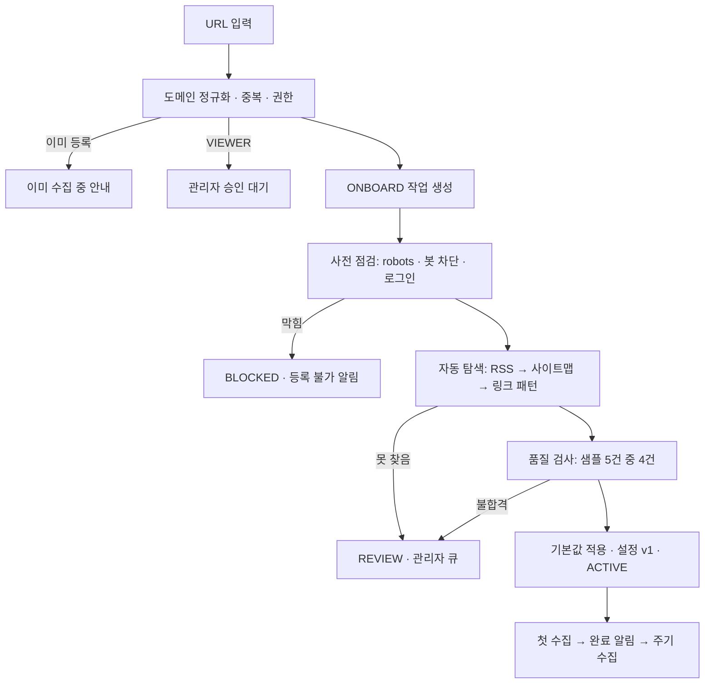

# 등록·내 요청

메뉴 **등록·내 요청** (`#/registrations`). 수집할 사이트를 등록하고 내가 넣은 요청이 어디까지 진행됐는지 봅니다.

## 이 탭에서 하는 일

- **사이트 등록**: 주소 한 건을 넣고 "등록". 기사 주소를 넣어도 사이트(도메인) 단위로 등록됩니다. 사전 점검·자동 탐색·첫 수집은
  자동으로 진행되고, 자동으로 판단할 수 없으면 사용자에게 다시 묻지 않고 관리자 확인으로 넘어갑니다.
  - **목록 주소**(예: 정책브리핑의 연설문 목록)를 넣으면 그 목록의 기사 종류만 켜고 수집합니다.
  - 이미 수집 중인 도메인에 다른 목록 주소를 넣으면 "중복"이 아니라 기존 소스에 그 기사 종류를 더합니다(설정 새 버전).
  - VIEWER가 등록하면 관리자 승인 뒤에 진행됩니다.
- **여러 개 등록** (REGISTRAR 이상): 한 줄에 주소 하나, `#` 뒤는 메모, 최대 500건. 한 건의 오류가 다른 건을 막지 않고,
  묶음 진행(완료·관리자 확인·반려·단계별 수)을 5초마다 다시 확인합니다.
- **내 요청**: 요청마다 상태·단계·결과 메시지. 진행 중인 요청이 있으면 자동으로 갱신합니다.
  링크 모음 페이지를 등록했으면 "언론사 N곳 진행 보기"로 대신 등록된 언론사 묶음을 봅니다. 관리자에게는 소스 상세 링크가 붙습니다.
- 챗봇에 "dart.fss.or.kr 수집해 줘"처럼 말해도 같은 등록이 됩니다 ([08-chatbot.md](08-chatbot.md)의 `register_source`).

## 어떻게 동작하나



- 사용자는 **URL 입력 한 번**만 합니다. 사전 점검 → 자동 탐색 → 품질 검사 → 기본값 적용 → 첫 수집은 시스템이 처리합니다.
  단계마다 무엇을 보는지는 [../how-collection-works.md](../how-collection-works.md) 1~6절에 있습니다.
- **소스 상태**: `PENDING → ACTIVE ⇄ PAUSED`, `ACTIVE → BROKEN(0건·급감) → 수정 → ACTIVE`,
  `ACTIVE → BLOCKED(403·429·챌린지) → 관리자 재점검 → ACTIVE 또는 EXCLUDED`.
- CAPTCHA·봇 차단·로그인 사이트는 **우회하지 않습니다.** 실패 사유로 분류하고 멈춥니다(BLOCKED).
- 사용자가 넣은 주소는 내부망 여부를 두 번 검사합니다: 백엔드는 주소 형식으로, 워커는 요청 직전 DNS 결과로 막습니다.
- **사이트 하나에 기사 종류가 여럿**이면(정책브리핑의 보도자료·정책뉴스·연설문 등, 상세 주소 모양이 다름) 등록 때 종류마다 품질 검사를 해
  켜고, 수집 때 실행당 상한을 종류별로 나눕니다. 정책브리핑은 종류 19개 중 7개(보도자료·정책뉴스·사실은 이렇습니다·부처 브리핑·국민이 말하는
  정책·연설문·청와대 브리핑)를 켭니다. 공공기관 게시판은 게시판 파라미터(`bbsId` 등) 값마다 종류로 나눕니다. 넘치는 종류는 꺼진 채 남아
  관리자가 소스 상세에서 켤 수 있습니다 ([09-admin.md](09-admin.md), 원리는 [../how-collection-works.md](../how-collection-works.md) 4-1절).
- **링크 모음(포털) 페이지**: 자동 탐색이 못 찾은 홈이 다른 언론사로 가는 링크 모음(뉴스스탠드 같은 포털 — 외부 언론사 도메인 10곳 이상이고
  외부 링크가 자기 기사형 링크보다 많을 때)이면 관리자 큐로 보내지 않고, 그 페이지가 가리키는 언론사들을 같은 요청자 이름으로 대신 등록합니다.
  이미 열린 소스와 상한(`SENSING_PORTAL_MAX_OUTLETS`)을 넘는 곳은 건너뜁니다. 모음 페이지 소스는 `EXCLUDED/PORTAL_EXPANDED`, 요청은 COMPLETED(메시지에
  묶음 id)이고, 언론사들은 묶음 `portal:<소스 id>`로 진행을 봅니다.
- **공개 API가 있는 제공처**(워커 API 카탈로그 `apis/catalog.py`에 있는 도메인, 첫 항목 DART)는 크롤링하지 않습니다. 사전 점검 없이
  "API 키 발급 필요"로 관리자 큐에 들어가고, 관리자가 키를 넣으면 자동으로 이어집니다 ([09-admin.md](09-admin.md)의 API 키).
- `news.naver.com`을 사이트처럼 등록하면 "키워드 감시로 등록하세요"(`KEYWORDS_REQUIRED`)로 안내합니다 — 네이버 뉴스 웹은 robots.txt가 전체 차단입니다.
- **일괄 등록이 주기 수집을 막지 않게** 워커 큐는 등록(ONBOARD)을 셋 집을 때마다 주기 수집(CRAWL)을 하나 먼저 집습니다(3:1 교대).
  묶음 안의 같은 주소는 첫 건만 등록하고, 형식 오류도 `INVALID`로 같은 묶음에 남깁니다(`registration_request.batch_id`).

### LLM 레시피 (선택)

LLM이 설정돼 있으면([llm.md](llm.md)) 워커가 홈과 샘플 기사 페이지를 LLM에 보여 주고, LLM이 허브·기사 URL 서명·추출 셀렉터를 JSON 레시피로 써냅니다.
레시피는 스키마 검증 → 셀렉터 문법·서명 형식 검사 → 허브에서 서명에 맞는 링크 3개 이상 → 기존 샘플 5건 품질 검사를 모두 통과해야
설정 버전(`recipe_source: "llm"`, `selectors`)으로 저장되고, 아니면 휴리스틱 탐색 결과를 씁니다. LLM 장애는 경고만 남기고 휴리스틱으로 진행하므로
LLM이 멈춰도 등록은 실패하지 않습니다. 기본값은 LLM을 쓰지 않는 것입니다. 측정 도구(`sensing-discovery-eval`)도 같은 변수를 읽고 결과 표에
레시피 출처를 표시합니다.

### 실측

실제 사이트 표본 10곳 중 9곳 자동 등록(2026-10-19 재측정 10/10), 주간지 8곳 중 6곳 자동 등록(REVIEW였던 한겨레21·주간한국은 10-19 규칙 보강 뒤
자동 등록), 뉴스스탠드 → 언론사 50곳 자동 등록, 현업 샘플 기사 3곳 3/3 적중. 표와 원인은 [../how-collection-works.md](../how-collection-works.md)의
"오늘 실측", 측정 방법은 [../progress.md](../progress.md)의 M1.

## 설정

워커 환경 변수입니다. LLM 제공자·모델·키는 [llm.md](llm.md)에 있습니다.

| 변수 | 기본값 | 설명 |
| --- | --- | --- |
| `HTTPS_PROXY` | (없음) | 사내망처럼 프록시로만 외부에 나가는 환경이면 지정 (프록시 환경은 내부망 검사를 주소 형식으로만 한다) |
| `SENSING_TLS_COMPAT` | `true` | TLS 핸드셰이크가 실패한 호스트를 호환 컨텍스트(`DEFAULT:@SECLEVEL=1`, TLS 1.2 이상, legacy renegotiation 허용, 인증서 검증은 유지)로 한 번 더 시도하고 성공하면 그 호스트는 계속 호환 설정으로 접속한다. RSA 키 교환만 지원하는 공공기관 사이트(예: 용인시)에 필요. 인증서 검증 실패는 재시도하지 않는다 |
| `SENSING_MAX_KINDS` | `7` | 등록 때 켜 둘 기사 종류 수 상한 (대표 종류 포함). 넘치는 종류는 꺼진 채 목록에 남아 관리자가 켤 수 있다 |
| `SENSING_MAX_KIND_CHECKS` | `8` | 대표 종류 말고 품질 검사할 종류 후보 수 상한 (후보 하나에 표본 5건 요청). `0`이면 종류를 늘리지 않는다 |
| `SENSING_PORTAL_MAX_OUTLETS` | `50` | 링크 모음 페이지 하나에서 대신 등록할 언론사 수 상한 |
| `SENSING_ONBOARD_RATIO` | `3` | 등록(ONBOARD)을 이 횟수 집을 때마다 주기 수집(CRAWL)을 한 번 먼저 집는다. `0`이면 ONBOARD를 항상 먼저 |
| `SENSING_LLM_MAX_SAMPLE_PAGES` / `SENSING_LLM_PAGE_CHARS` / `SENSING_LLM_TIMEOUT` | `5` / `30000` / `120` | 레시피: LLM에 보여 줄 샘플 페이지 수, 페이지당 글자 수 상한(script·style·svg 제거 후), 요청 제한 시간(초) |

## API

```bash
# 사이트 등록 (기사 주소를 넣어도 도메인으로 등록. 목록 주소를 넣으면 그 목록의 기사 종류만 켜고, 이미 수집 중인 도메인이면 기존 소스에 그 종류를 더한다)
curl -X POST http://127.0.0.1:8080/api/v1/registrations -H 'X-User: registrar' \
     -H 'Content-Type: application/json' -d '{"url":"https://news.example.com/news/articleView.html?idxno=1"}'

# 내 등록 요청과 진행 단계
curl http://127.0.0.1:8080/api/v1/registrations/mine -H 'X-User: registrar'

# 사이트 일괄 등록 (REGISTRAR 이상, 최대 500건. JSON 배열 또는 text/plain 한 줄에 하나·# 뒤는 메모. 한 건의 오류가 다른 건을 막지 않는다) → batchId
curl -X POST http://127.0.0.1:8080/api/v1/registrations/bulk -H 'X-User: registrar' -H 'Content-Type: text/plain' --data-binary @docs/eval-sites.txt
# 몇 분 뒤: 묶음의 completed·review·rejected·byStatus·byStep (링크 모음 페이지가 대신 등록한 언론사는 batches/portal:<소스 id>)
curl http://127.0.0.1:8080/api/v1/registrations/batches/<batchId> -H 'X-User: registrar'
```

승인·반려는 관리자 처리 대기 큐에서 합니다 ([09-admin.md](09-admin.md)).

## 한계와 주의

- 봇 확인 화면·로그인이 필요한 사이트는 등록되지 않습니다(예: daily.hankooki.com의 `BOT_CHALLENGE`). 원칙대로 우회하지 않습니다.
- 규칙과 LLM 레시피가 모두 못 잡는 사이트는 관리자 확인(REVIEW)으로 갑니다.
- 스크립트로 그리는 동적 사이트(Playwright)와 첨부(HWP/PDF) 본문 추출은 아직 없습니다(M4).
- 평소 수집은 입구에 지금 보이는 기사만 모읍니다. 등록 이전 기사는 관리자가 [과거 기사 채우기](09-admin.md#과거-기사-채우기)로 따로 요청합니다.
